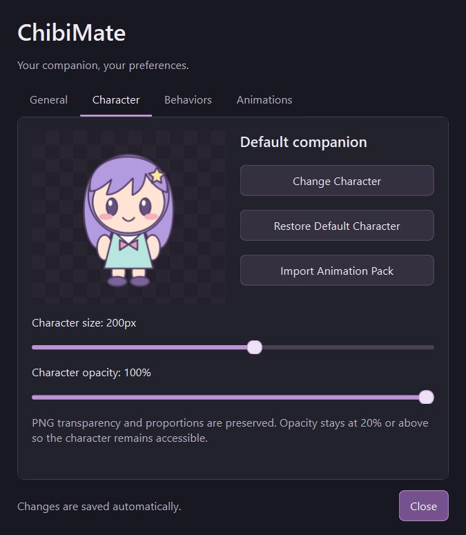

# ChibiMate

A customizable Windows desktop companion built with Python and PySide6. Keep a
small character on your desktop, give it its own animation pack, and control its
appearance and behavior from a compact settings window.

**v0.1.0 is being prepared as a portable Windows pre-release.** The public build
uses an original, code-drawn placeholder. Character artwork and animation packs
are separate; no paid service is needed for normal use.

## Features

- Transparent, borderless character with optional always-on-top behavior.
- Dragging, automatic walking, facing direction, and screen boundaries.
- Optional cursor following and autonomous actions; manual interactions take priority.
- Click reactions and short speech bubbles, without AI chat.
- Custom PNG characters and offline folder/ZIP animation packs.
- Dark settings window with preview, size, opacity, behavior, and playback controls.
- Persistent preferences and imported assets; tray controls to restore a hidden companion.
- Optional reference-image AI generator, configured separately.

## Screenshot

Actual Windows EXE settings window using the public build's original placeholder:



## Windows download and launch

Once published, download **ChibiMate-Windows-v0.1.0.zip** from
[GitHub Releases](https://github.com/PierreLawrenceMarbella/ChibiMate/releases).
Choose the Windows ZIP asset, not GitHub's automatically generated source archives.

1. Right-click the ZIP and choose **Extract All**.
2. Open the extracted `ChibiMate` folder.
3. Double-click **ChibiMate.exe**.

Keep `_internal` and the other included files beside the EXE. Do not run it inside
the ZIP or copy just the EXE elsewhere. Python, VS Code, and an API key are not
required. This is a portable folder distribution, **not an installer**.

Target: **64-bit Windows 10/11**. The build is unsigned and may show a Windows
publisher warning. Testing on additional clean Windows PCs is still needed.

### Desktop controls

- **Left-click:** reaction and dialogue. **Hold and drag:** reposition the character.
- **Right-click:** actions, Pause/Resume Movement, Follow Cursor, customization, and Exit.
- **Character Settings:** live appearance, behavior, and animation controls.
- **Return to Idle / Wake Up:** stop a pose or wake a sleeping character.
- **Hide:** restore using the system-tray icon. Hide is disabled without a system tray.
- **Exit ChibiMate:** close the application. A second launch exits; if the character
  is hidden, use the existing tray icon.

## Character customization

Choose **Change Character** and select a readable PNG. Transparency is recommended;
backgrounds are not automatically removed. The full image is scaled proportionally.
Settings offer size (75–300 logical pixels), opacity (20–100%), and always-on-top.

The PNG is copied to `%LOCALAPPDATA%\ChibiMate`, along with preferences and imported
packs. Moving the original file does not remove the saved character. Invalid or
missing saved images fall back to the default. **More Customization → Restore
Default Character** restores the public placeholder; source mode labels this
**Restore Default Alya**. Size preferences are preserved.

A custom PNG remains a static image during movement until you supply its own
frames. It never inherits Alya's animation frames.

## Offline animation packs

Select the intended character first, then choose **Import Animation Pack**.
Select either an unpacked folder or a ZIP with the same contents:

```text
MyCharacter/
  idle/
    idle_01.png
  walk/
    walk_01.png
    walk_02.png
    ...
  blink/
    blink_01.png
  happy/
    happy_01.png
```

Put action folders directly at the ZIP root, or inside one character wrapper
folder. Include only the desired character's frames; omit unused folders and
backup/originals directories. Preview the available actions, choose playback FPS,
then **Apply** or **Cancel**. Applying associates the pack with the selected
character across restarts. Source artwork is never overwritten.

| Supported actions | Accepted folder names |
| --- | --- |
| Idle, walking, running | `idle`, `walking` / `walk`, `running` / `run` |
| Sitting, waving, dancing | `sitting` / `sit`, `waving` / `wave`, `dancing` / `dance` |
| Sleeping, peeking | `sleeping` / `sleep`, `peeking` / `peek` |
| Expressions | `happy`, `sad`, `angry`, `shy`, `surprised` |
| Blinking | `blink` |

Frames load in numerical filename order. Different actions may have different
frame counts: one image is a **static pose**, multiple distinct images animate.
Transparency, aspect ratio, and bottom-center alignment are preserved. Consistent
canvas sizes and character proportions give the best results. Missing actions
use idle, the current PNG, or dialogue; unavailable manual poses are disabled.

Limits: 256 PNGs, 512 entries, 2048px per side, 12 MB per PNG, 24 megapixels decoded
in total, and 100 MB compressed/expanded. Unsafe paths, links, duplicate paths,
corrupt images, and entirely transparent frames are rejected. Custom character
PNGs have separate limits of 32 MB, 8192px per side, and 24 megapixels.

**Included artwork:** the public ZIP has no frame-based animations. The development
assets contain idle (1), walk (8), blink (1), happy (1), and surprised (1). Running,
sitting, waving, dancing, sleeping, sad, angry, shy, and peeking need supplied assets.
The engine supports them; it does not generate missing artwork.

## Optional AI Chibi Generator

Normal use and animation-pack imports work offline. The optional generator sends
the chosen reference image and prompt to OpenAI **only after Generate Chibi is
clicked**. It requires separately configured provider access and may incur API
charges. No shared API key is bundled.

Set `OPENAI_API_KEY` in the environment before starting the application. For example,
in a local PowerShell session from the project directory:

```powershell
$env:OPENAI_API_KEY = "your-own-key"
& .\dist\ChibiMate\ChibiMate.exe
```

For a downloaded ZIP, launch its extracted EXE instead. Do not put a real key in
source files or commit it. The app does not load `.env` files itself. Restart it
after changing environment variables.

Open **More Customization → AI Chibi Generator**, select a PNG/JPG/JPEG/WebP
reference, optionally add instructions, and generate. Preview before choosing
**Use as ChibiMate** or **Save PNG**. Accepted images are stored under
`%LOCALAPPDATA%\ChibiMate\generated-characters`; rejected previews are not saved
as permanent characters. Generated characters are static PNGs, not sprite packs.

`CHIBIMATE_IMAGE_MODEL` overrides the configured model. The implementation currently
defaults to `gpt-image-2.5-flare` with one low-quality 1024×1024 PNG, requesting a
transparent background. Model availability and account access must be checked
separately; these settings were not validated with a paid request. Resemblance and
transparency are not guaranteed. Canceling locally may not prevent provider charges.

## Developer setup

Use Python 3.11+ (64-bit on Windows):

```powershell
git clone https://github.com/PierreLawrenceMarbella/ChibiMate.git
cd ChibiMate
python -m venv .venv
.\.venv\Scripts\python.exe -m pip install -r requirements.txt
.\.venv\Scripts\python.exe main.py
```

Source mode retains the existing Alya assets and eight-frame walking cycle. The
public build uses the original placeholder instead. Asset loading works independently
of the launch directory. Both modes share the user-data directory, but their
default-character pack associations are separate.

### Build and prepare a Windows ZIP

```powershell
.\.venv\Scripts\python.exe -m pip install -r requirements-build.txt
powershell -NoProfile -ExecutionPolicy Bypass -File .\build_windows.ps1
.\.venv\Scripts\python.exe package_windows.py
```

Outputs: `dist\ChibiMate\ChibiMate.exe` and
`releases\ChibiMate-Windows-v0.1.0.zip`, with a SHA-256 checksum alongside the ZIP.
Packaging reuses the existing build; rebuild first after changing application code
or dependencies. It includes only the distribution and explicitly selected
documentation/notices, never source assets or the user-data directory.

Run available checks with:

```powershell
.\.venv\Scripts\python.exe -m unittest discover -s tests -v
```

Technology: Python, PySide6/Qt Widgets, QTimer, QSettings, standard-library ZIP
handling, PyInstaller, and the optional official OpenAI Python SDK. There is no
game engine or database. See [release notes and publishing steps](RELEASE_NOTES.md).

## Known limitations

- Unsigned Windows x64 pre-release; no installer, updater, or code signing.
- Development-machine checks do not establish compatibility with every PC,
  Windows version, or display scaling configuration.
- Following and edge actions stay within the current monitor's available area;
  drag to change monitors. Peeking stays visible and does not hide behind windows.
- Animation quality depends on supplied frames. Static PNGs do not acquire genuine
  walking, blinking, or dancing animations automatically.
- AI generation requires network access and separately billed provider access;
  no paid API calls were made during release preparation.

## License and attribution

No project-wide software license has been selected or added. Do not describe this
repository as licensed open-source software until the owner chooses a license.

The public Windows ZIP uses the original placeholder drawn by `app/character.py`.
Alya (Alisa Mikhailovna Kujou) is a character from *Alya Sometimes Hides Her Feelings
in Russian*. ChibiMate is not affiliated with its creators or rights holders.
Redistribution permission for the development artwork is unconfirmed. Those images
and `exports/Alya_Animation_Pack.zip` are excluded from the Windows ZIP, but remain
tracked in the repository; attribution does not resolve that pending source-publication
issue. No original assets were deleted.

Dependency notices accompany the distribution. See [third-party notices](THIRD_PARTY_NOTICES.md)
for included license texts, upstream sources, and review items before publication.
